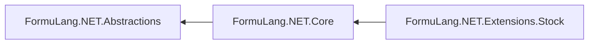

<div align="center">


**FormuLang.NET** is a multi-platform, modular C# library implementing the [**FormuLang**](https://github.com/Adisoreq/FormuLang) standard.


[](https://www.nuget.org/packages/FormuLang.NET.Core)
[](docs/conformance.md)

[**Documentation**](docs/README.md) · [**Getting started**](docs/getting-started.md) · [**Conformance**](docs/conformance.md) · [**Changelog**](CHANGELOG.md)

---

**Web preview** available here:

<a href="https://adisoreq.github.io/formulang-dotnet/">
  
</a>

</div>


## Overview

[**FormuLang**](https://github.com/Adisoreq/FormuLang) is a formula-based scripting language standard: a host application embeds an interpreter and lets its users write text formulas such as

```php
$principal := 1000
$rate := 0.05
$principal * (1 + $rate) ^ 10
```

**FormuLang.NET** is the reference implementation of that standard for .NET. It turns a formula into a single result value by running the execution pipeline defined by the standard:

**Validation** → **Clean-up** → **Tokenization** → **Parsing** → **Evaluation**

Each stage is defined by an interface in `FormuLang.NET.Abstractions` and implemented in `FormuLang.NET.Core`, so a host application can replace any single stage with its own implementation.


## Library modules

Module list:

| Module | Description |
| :----- | :---------- |
| [**FormuLang.NET.Abstractions**](src/FormuLang.NET.Abstractions) | Interfaces and enumerations shared by every module: primitives (`IValue`, `IType`, `IContainer`, `IFunction`), pipeline stages (`IValidator`, `ICleaner`, `ITokenizer`, `IParser`, `IEvaluator`), structures (`IEnvironment`, `IContext`, `IStandard`). No dependencies. |
| [**FormuLang.NET.Core**](src/FormuLang.NET.Core) | Implementation of the **Core** standard: the execution pipeline, primitives, errors, operators, built-in functions and procedures. |
| [**FormuLang.NET.Extensions.Stock**](src/FormuLang.NET.Extensions.Stock) | Implementation of the **Stock** extension standard: the `Stock.Candle` type, the Stock, Indicator, Pattern and Strategy contexts, the formula registry of indicators and patterns, `CANDLE`, `IS_BULLISH`, `IS_BEARISH`, `LOAD_INDICATOR` and `LOAD_PATTERN`. |

Dependency tree:



More: [Architecture](docs/architecture.md).


## Installation

The modules are published on NuGet as separate packages. `FormuLang.NET.Core` brings `FormuLang.NET.Abstractions` with it.

```bash
dotnet add package FormuLang.NET.Core
```

```bash
dotnet add package FormuLang.NET.Extensions.Stock
```

| Package | Standard |
| :------ | :------- |
| [FormuLang.NET.Abstractions](https://www.nuget.org/packages/FormuLang.NET.Abstractions) | - |
| [FormuLang.NET.Core](https://www.nuget.org/packages/FormuLang.NET.Core) | `core-1.0` |
| [FormuLang.NET.Extensions.Stock](https://www.nuget.org/packages/FormuLang.NET.Extensions.Stock) | `stock-1.0` |


## Quick example

```csharp
using FormuLang.NET.Core.Processing;
using FormuLang.NET.Core.Structures;
using Environment = FormuLang.NET.Core.Structures.Environment;

var environment = Environment.Create();       // Core standard: functions, constants, variables
var context = Context.Create(environment);    // basic Core context, chosen by the host application

ExecutionResult result = Executor.Create().Execute("""
    $principal := 1000
    $rate := 0.05
    ROUND($principal * (1 + $rate) ^ 10, 2)
    """, context);

Console.WriteLine(result.Successful ? result.Value : result.Error);   // 1628.89
```

The host application chooses the context a formula runs in: the basic Core context, a persistent one, or a context type that provides its own data (e.g. the candles of a stock indicator). Errors are values: a formula that fails returns an **Error** such as `[OPERATION_ERROR (3)] Division by zero.` instead of throwing. See [Getting started](docs/getting-started.md) and the [CalculatorCLI sample](samples/CalculatorCLI).


## Building

Requirements: [.NET SDK 8.0](https://dotnet.microsoft.com/download) or newer.

```bash
dotnet build FormuLang.NET.sln
```

```bash
dotnet test FormuLang.NET.sln
```

The tests include the language-independent [conformance tests](tests/FormuLang.NET.Conformance.Tests) of the standard. Releases are described in [Development](docs/development.md#releasing).


## Related projects

- [**FormuLang**](https://github.com/Adisoreq/FormuLang)
<br> Language standard, reference point for syntax and semantics rules.

- [**FormuLang-TS**](https://github.com/Adisoreq/formulang-ts)
<br> TypeScript implementation of the standard.


## Authors

Adrian Piznal


## License

The library is licensed under the [MIT License](LICENSE).
The FormuLang standard documentation is licensed separately, under [CC BY 4.0](https://github.com/Adisoreq/FormuLang/blob/main/LICENSE.txt).

<div align="center">

</div>
